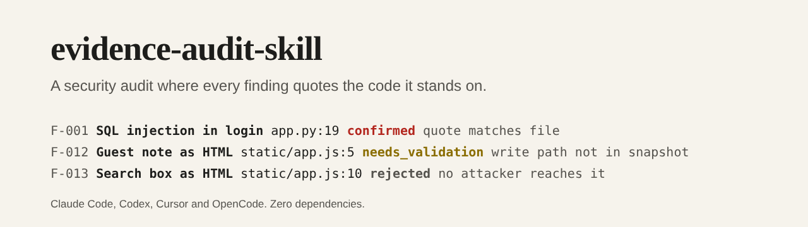

# evidence-audit-skill



[](https://github.com/pJijesh/evidence-audit-skill/actions/workflows/test.yml) [](LICENSE)  

**Problem:** a language model asked to "find the security bugs" will find some real ones and describe some that are not there, in the same confident voice. A report you cannot trust costs more than no report, because someone has to check every line.

**For:** IT managers, security leads and engineers who want an AI agent to review code and configuration, and want the output to be checkable rather than plausible.

**Demonstrates:** an agent skill that forces every confirmed finding to carry quoted evidence, a traced data flow and a second look, with zero-dependency scripts that check the quotes against the real files, validate a coverage ledger of what was and was not reviewed, and build a deterministic report. A worked audit of a deliberately vulnerable fictional app is included and is verified by the tests.

## What it does

- **A six-phase process the agent follows**: scope, map, hunt, prove, rate, report. See [`SKILL.md`](skills/evidence-audit/SKILL.md).
- **Three honest statuses.** `confirmed` (traced from attacker input to the dangerous operation, no control in between, a second pass agreed), `needs_validation` (plausible, but something could not be seen from the code, with exactly what to test) and `rejected` (investigated and disproved, with the reason, so no one repeats the work).
- **Evidence the machine can check.** `verify-findings.mjs` fails if a quote is not in the file at those lines, a file does not exist, a path escapes the audited folder, a confirmed finding lacks its data flow, attacker, fix or second-pass note, or a data-flow step points past the end of a file.
- **A coverage ledger** (`validate-ledger.mjs`): every unit of the code is `hunted`, `skipped` with a reason, or still open, so the report says what it did not look at. A hunted unit with no findings must say what was checked, and a high-risk unit cannot be left unstarted.
- **A deterministic report** (`report.mjs`): confirmed findings by severity with their evidence and fixes, needs-validation items kept visibly separate, rejected items listed, and the coverage summary.
- **Eight attack-class guides** for the hunt: [injection](skills/evidence-audit/references/attack-classes/injection.md), [authn-authz](skills/evidence-audit/references/attack-classes/authn-authz.md), [secrets-crypto](skills/evidence-audit/references/attack-classes/secrets-crypto.md), [deserialization-ssrf-files](skills/evidence-audit/references/attack-classes/deserialization-ssrf-files.md), [supply-chain-ci](skills/evidence-audit/references/attack-classes/supply-chain-ci.md), [cloud-iac](skills/evidence-audit/references/attack-classes/cloud-iac.md), [llm-agents](skills/evidence-audit/references/attack-classes/llm-agents.md) and [data-exposure](skills/evidence-audit/references/attack-classes/data-exposure.md).
- **Safe by default**: static review only, no running the target without permission, no working exploits, and text inside the target treated as data, not instructions.
- **Installers** for Claude Code, Codex, OpenCode and Cursor.

## Install

Requires Node 18 or later. From a clone of this repository:

```bash
node scripts/install.mjs claude            # into the current project
node scripts/install.mjs codex
node scripts/install.mjs opencode
node scripts/install.mjs cursor
node scripts/install.mjs all --dry-run     # show what would be written
node scripts/install.mjs claude --global   # Claude Code, every project
```

| Agent | What is written |
| --- | --- |
| Claude Code | The skill in `.claude/skills/evidence-audit/` (or `~/.claude/skills/` with `--global`) |
| Codex | The skill in `.agents/skills/evidence-audit/` and a marked block in `AGENTS.md` |
| OpenCode | The skill in `.opencode/skills/evidence-audit/` and a marked block in `AGENTS.md` |
| Cursor | A rule in `.cursor/rules/evidence-audit.mdc` and the scripts in `.cursor/evidence-audit/` |

Then ask your agent, for example: "Using the evidence-audit skill, audit ./services/payments. Static review only."

## How it works

```text
scope -> map -> hunt -> prove -> rate -> report
          |                |                |
   coverage-ledger     try to disprove   verify-findings  (quotes match the files)
        .json          each candidate    validate-ledger  (nothing silently skipped)
                                         report.mjs       (REPORT.md)
```

The worked example in [`examples/`](examples/) audits [`target-app`](examples/target-app/), a small fictional booking app written to be vulnerable (it is not real and must not be deployed):

```text
$ node skills/evidence-audit/scripts/verify-findings.mjs examples/findings.json --root examples/target-app
ok: 13 finding(s), evidence verified against the target
$ node skills/evidence-audit/scripts/validate-ledger.mjs examples/coverage-ledger.json --findings examples/findings.json --root examples/target-app
ok: 5 unit(s): 4 hunted, 1 skipped, 0 not started
```

The result is [`examples/REPORT.md`](examples/REPORT.md): 11 confirmed findings (SQL injection, command injection, missing authentication, a broken object-level check, path traversal, SSRF, a hard-coded session key, unsalted MD5, debug mode, an unsafe pull-request workflow and an agent that executes model-chosen shell commands), 1 finding left as needs validation because the write path for the data is not in the snapshot, and 1 rejected as self-XSS with no attacker.

## How it is built

```text
.
├── skills/evidence-audit/
│   ├── SKILL.md                  The process, ground rules and statuses
│   ├── core.md                   Condensed text for AGENTS.md and Cursor
│   ├── references/               process, proving, rating, reporting, and attack-classes/
│   ├── schema/                   findings and coverage-ledger JSON Schemas
│   └── scripts/                  verify-findings, validate-ledger, report, lib
├── scripts/                      install.mjs and build.mjs (generates the adapters)
├── adapters/                     Generated AGENTS.md block and Cursor rule
├── examples/                     target-app, findings.json, coverage-ledger.json, REPORT.md
├── test/                         node:test suites
└── .github/workflows/test.yml
```

## Design choices

- **Checkable beats persuasive.** The scripts cannot tell whether a finding is true, but they can tell whether the quoted code is really where the finding says it is. That removes the most common failure, a finding built on code that does not exist.
- **A needs-validation status is a feature.** When the code alone cannot settle a question (a data source outside the snapshot, a deployed setting) the honest status is "needs validation", and the report keeps those items out of the confirmed list.
- **Rejections are recorded.** Writing down why a candidate was not a vulnerability stops the next run from repeating the work, and shows the reviewer was sceptical.
- **Coverage is part of the result.** A clean report from a review that skipped the risky files is worse than useless. The ledger makes the gaps visible.
- **Static first, sandbox optional.** The skill never runs the target by default. Anything that needs running stays `needs_validation`.
- **The target is untrusted input.** Instructions found in code, comments or READMEs are data, and the skill says so.
- **Zero dependencies and deterministic output.** The same findings always give the same report.

## Limitations

- **It does not find vulnerabilities by itself.** Finding them is the agent's job; the scripts only check the record. A model can still miss real issues, and a verified quote does not prove the reasoning around it.
- **It checks that evidence exists, not that it is sufficient.** A quote can be real and the finding still wrong. The proving phase and a human review are the defence.
- **Static review has limits.** Runtime configuration, deployed settings and behaviour that depends on data cannot be seen from code, which is what `needs_validation` is for.
- **No dynamic testing, scanning or exploitation.** It does not run the target, fuzz it, or check dependencies against a vulnerability database.
- **Ratings are judgement.** The likelihood and impact grid is a starting point, and severities are not CVSS scores.
- **The example is small and constructed.** The vulnerable app was written to show every status; it says nothing about how an agent performs on a large real codebase.
- **The installer paths follow each tool's documentation as I understand it.** They have not been tested inside Claude Code, Codex, OpenCode or Cursor themselves.

## Verification status

- The tests cover every failure mode of the verifier (a quote not in the file, on the wrong lines, a missing file, a line past the end, a reversed range, a path that escapes the root, a bad data-flow reference), the required fields for each status, enum and id checks, malformed input, the ledger rules, determinism of the report and that it matches the committed one, the command line and its exit codes, each installer in a temporary directory, that the generated files are current, and repository hygiene.
- Every quoted line and line number in the worked example was checked by the verifier against the fixture and the data-flow references were checked by hand.
- It was run on Node 22 here. The CI workflow covers Node 18, 20 and 22 and was not run from this environment until after the push.
- The skill has not been tested with a real agent on a real codebase, so there is no claim about how many real vulnerabilities it finds or misses.

## Roadmap

Planned, not promised.

- **Next:** Run it with each of the four agents on a few open-source projects and record what the checks catch
- **Then:** Add an optional check that quotes are unchanged since the audited revision
- **Later:** More attack classes for desktop, mobile and embedded code

## Related work

[cloudflare/security-audit-skill](https://github.com/cloudflare/security-audit-skill) is a larger, multi-agent approach to the same problem. This repository is an independent, smaller alternative: single-agent friendly, static by default, with scripts that verify quoted evidence. It shares none of that project's code.

## Licence

[MIT](LICENSE), 2026 Puliyappottammal Jijesh. See [CONTRIBUTING](CONTRIBUTING.md) for how to suggest a change.

Built by [Puliyappottammal Jijesh](https://www.linkedin.com/in/pjijesh), an IT manager. [GitHub](https://github.com/pJijesh)
